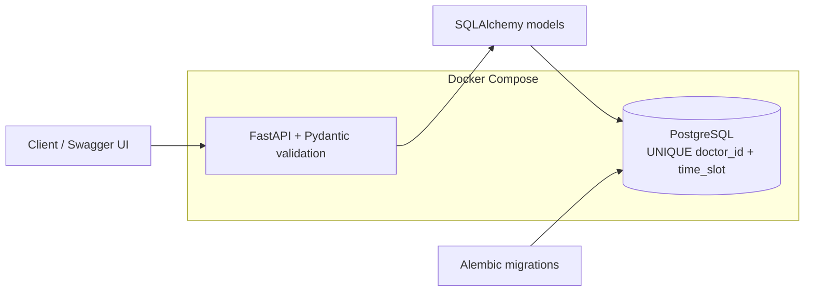
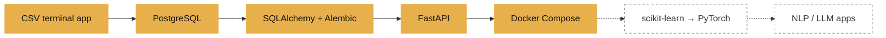

<h1 align="center">Rania Rashid</h1>

BS Artificial Intelligence student · Ghazi University, Dera Ghazi Khan, Pakistan (2025–2029) 
Building toward AI engineering: backend and data foundations first, then ML and NLP/LLMs. 
<b>Open to remote internships and freelance projects.</b>

<a href="https://www.linkedin.com/in/rania-rashid00/">LinkedIn</a> ·
<a href="https://raniarashid780-sketch.github.io/">Portfolio</a> ·
<a href="mailto:raniarashid780@gmail.com">Email</a>

---

## Projects

### [SmartCare-Clinic](https://github.com/raniarashid780-sketch/SmartCare-Clinic)
Clinic appointment system, rebuilt in stages from a terminal script into a REST API.
- **Database:** four tables with foreign keys; `UNIQUE(doctor_id, time_slot)` blocks the same doctor being booked twice in the same slot at the database level; schema changes go through versioned Alembic migrations.
- **API:** FastAPI endpoints with Pydantic validation; rule-based symptom routing to specialties and urgent-case billing.
- **Deployment:** Docker Compose runs the API and PostgreSQL as two containers, with healthcheck-gated startup, automatic migrations, and a persistent data volume.
- **Known limit:** the constraint blocks identical slots only; overlapping appointment windows are not yet prevented.

`Python · FastAPI · PostgreSQL · SQLAlchemy · Alembic · Docker`

### [File Organizer](https://github.com/raniarashid780-sketch/File-Organizer)
Sorts Downloads and Desktop files by type and date. [Live demo →](https://raniarashid780-sketch-file-organizer-autom-streamlit-app-sypeq4.streamlit.app/)
- **Built to be safe:** colliding names get a numbered suffix instead of overwriting; `--dry-run` previews every move; pytest suite.
- **Two bugs I found in my own first version and fixed:** silent overwrites when two files shared a name, and the script re-scanning its own output folders on rerun.

`Python · pathlib · pytest · Streamlit`

### [FreelanceLens](https://github.com/raniarashid780-sketch/Freelancelens)
Analysis of 24 manually collected Upwork listings: most requested skills and average posted budget by category, with fixed-price and hourly kept separate because they are different units.
- **Limits stated up front:** small sample (several categories have only 2–3 listings), budgets recorded at range minimum, posted budgets are not realized pay. Results are directional only.

`Python · pandas · NumPy · matplotlib`

---

## The path so far

Solid = shipped in SmartCare-Clinic. Dashed = what I'm learning next.

---
## How I work
- Schema changes are migrations, not manual edits.
- Safety before speed: preview, collision handling and tests before a tool touches real files.
- I write down a project's limits next to its results.
- Configuration comes from environment variables, not code.

## Learning now
Linear algebra, probability and statistics, and machine learning with scikit-learn; then PyTorch, NLP and LLM applications.

## Stack

Python · SQL · PostgreSQL · SQLAlchemy · Alembic · FastAPI · Pydantic · Docker · pandas · NumPy · matplotlib · Streamlit · pytest · Git

## Certifications
- Google IT Automation with Python Professional Certificate ([credential](https://www.coursera.org/account/accomplishments/specialization/WD7H4D5P9PVF))
- TEVTA Certified Computer Operator

### 📊 GitHub Stats

<picture>
  <source media="(prefers-color-scheme: dark)" srcset="https://github-readme-stats-chi-one-fhtsy394dj.vercel.app/api?username=raniarashid780-sketch&show_icons=true&theme=dark&hide_border=true&count_private=true">
  <source media="(prefers-color-scheme: light)" srcset="https://github-readme-stats-chi-one-fhtsy394dj.vercel.app/api?username=raniarashid780-sketch&show_icons=true&theme=default&hide_border=true&count_private=true">
  
</picture>

<picture>
  <source media="(prefers-color-scheme: dark)" srcset="https://github-readme-stats-chi-one-fhtsy394dj.vercel.app/api/top-langs/?username=raniarashid780-sketch&layout=compact&theme=dark&hide_border=true">
  <source media="(prefers-color-scheme: light)" srcset="https://github-readme-stats-chi-one-fhtsy394dj.vercel.app/api/top-langs/?username=raniarashid780-sketch&layout=compact&theme=default&hide_border=true">
  
</picture>

---